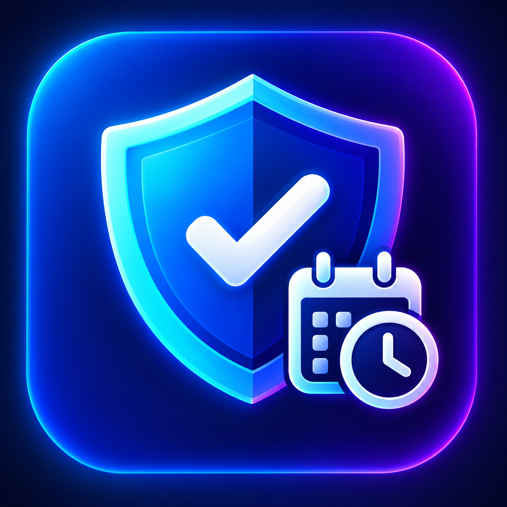
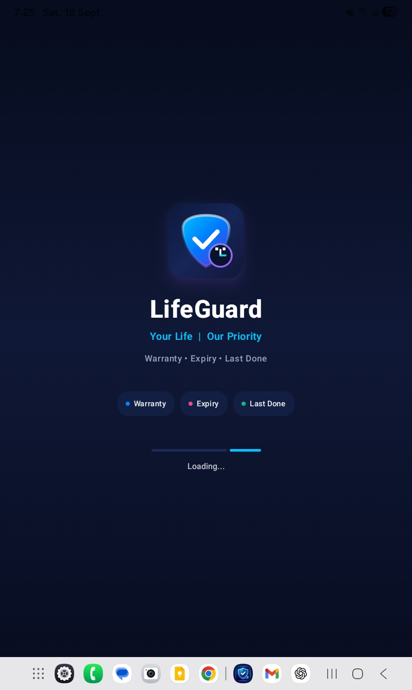
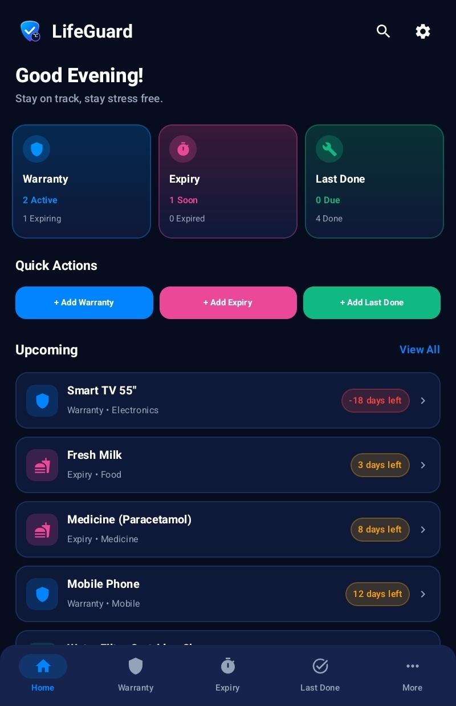
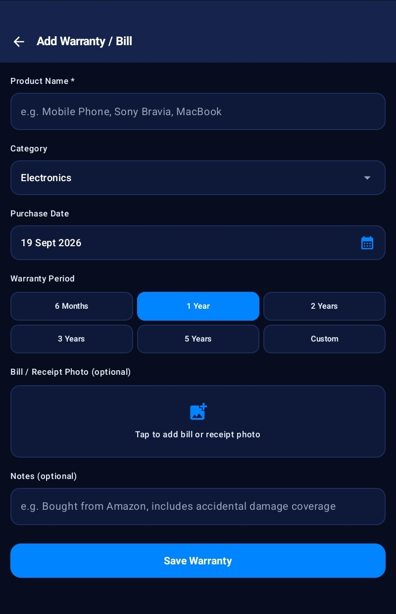
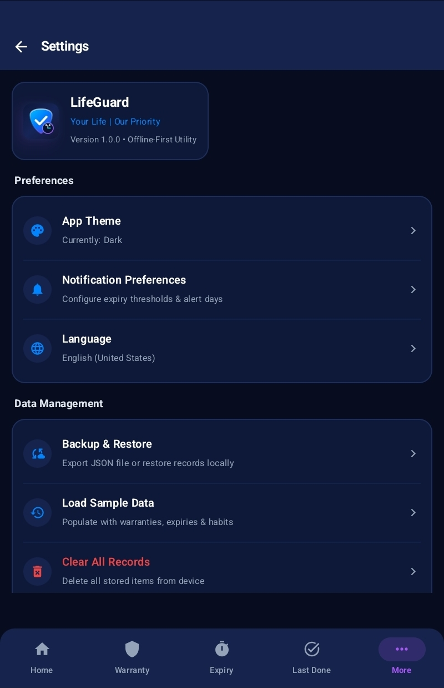
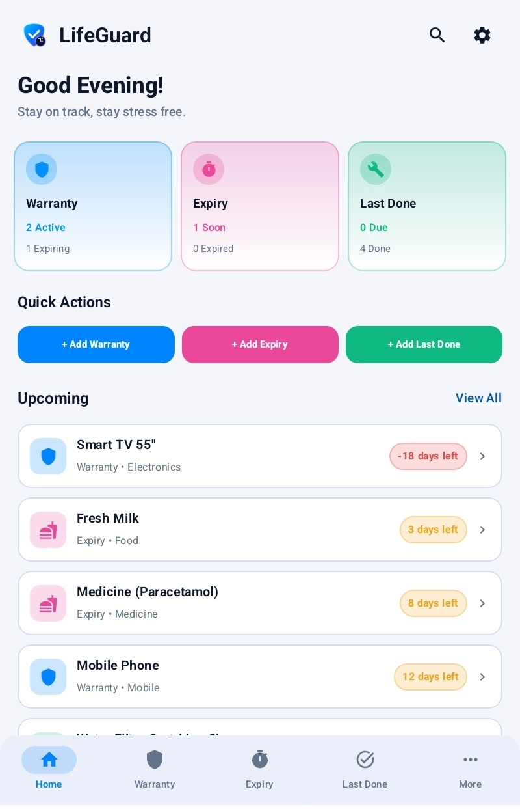
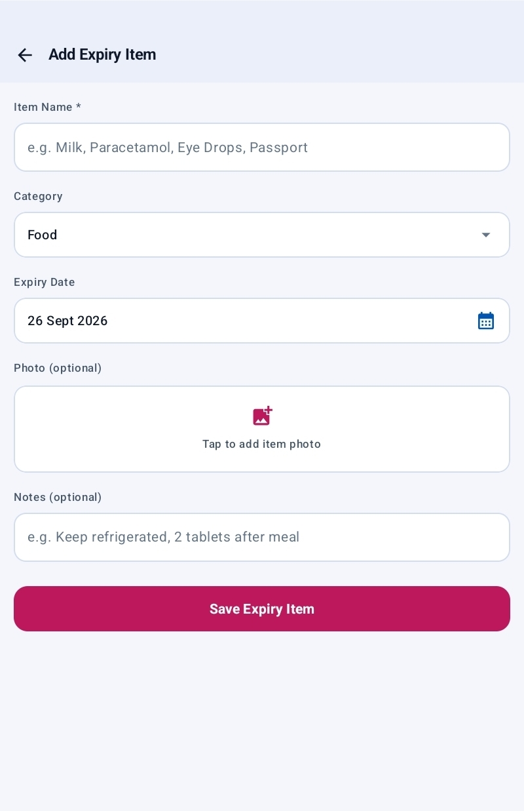
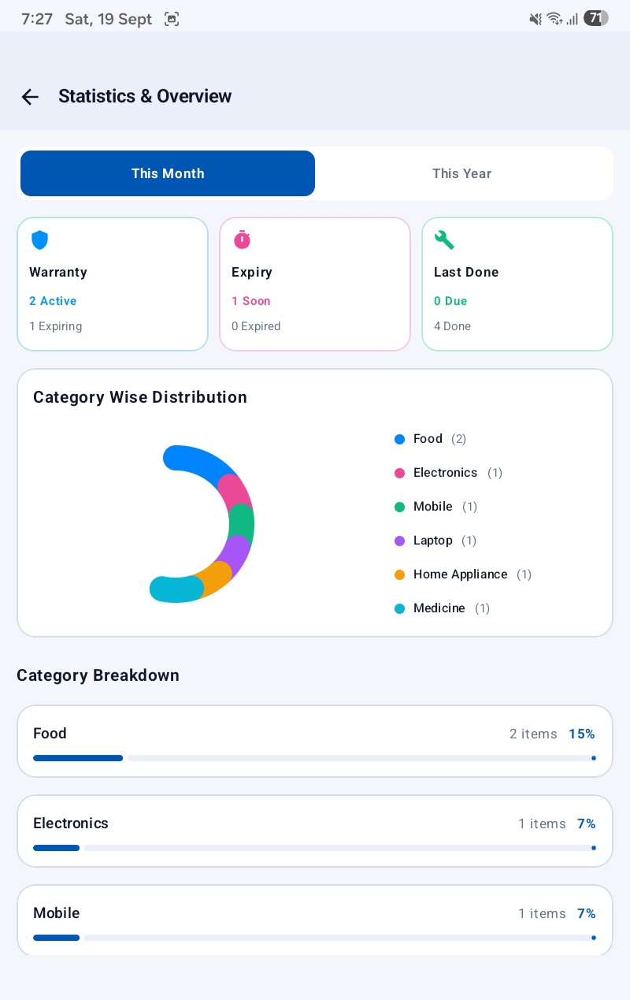
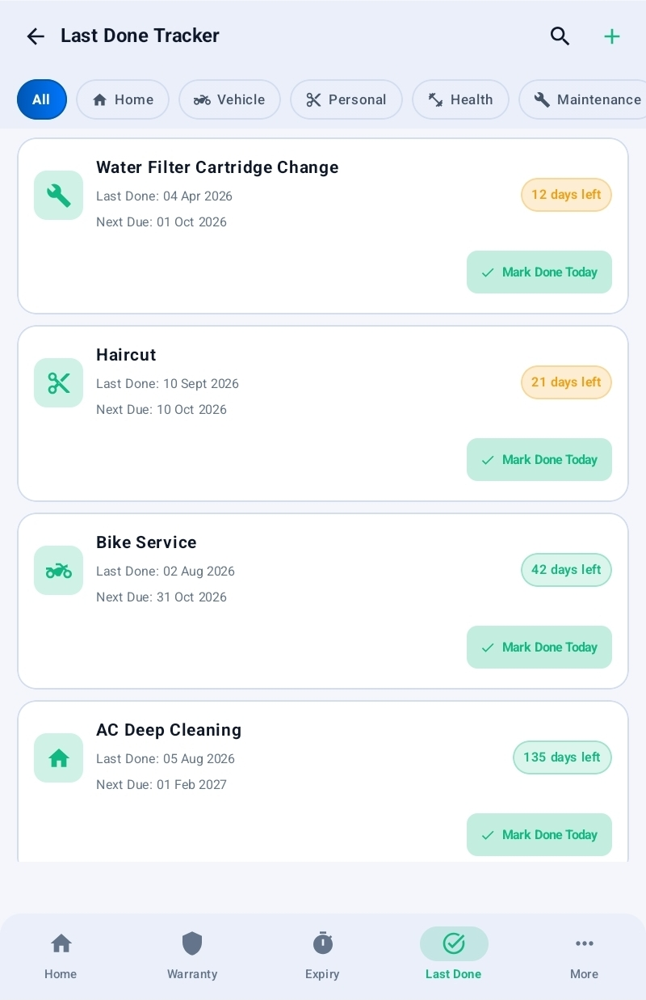
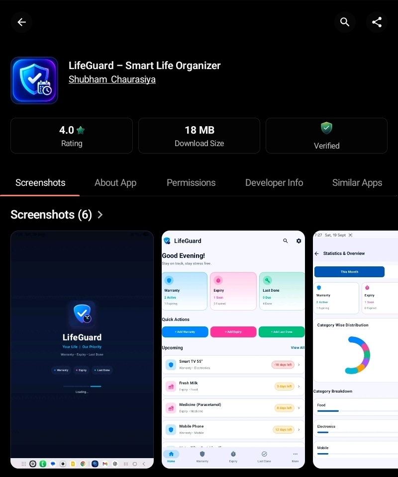

  
  
  🛡️ LifeGuard – Smart Life Organizer

Organize Your Life. Never Miss What Matters!

Your Everyday Organization Partner

A simple, smart and convenient Android application designed to help you manage product warranties, bills, expiry dates, reminders and everyday activities — all in one place.

   

---

🌟 Welcome to LifeGuard

LifeGuard – Smart Life Organizer is an easy-to-use Android application that helps you keep your important information organized and accessible.

Managing product warranties, keeping purchase bills, tracking expiry dates and remembering everyday activities can sometimes become difficult.

LifeGuard brings these useful organization tools together in one convenient application.

Whether you want to maintain household product records, organize important bills or keep track of important dates, LifeGuard makes everyday management simpler.

🎯 Our Goal

Our goal is to make everyday organization easier by bringing useful tracking and management tools into one simple application.

---

✨ Key Features

LifeGuard comes with several useful features designed to make everyday organization easier.

<table>
<tr>
<td width="50%" valign="top"><h3>🛡️ Warranty Management</h3>Keep track of purchased products, purchase dates and warranty periods. Maintain organized warranty records for your important products.

</td>
<td width="50%" valign="top"><h3>🧾 Bill Management</h3>Keep your important purchase bills and related information organized in one convenient place.

</td>
</tr><tr>
<td width="50%" valign="top"><h3>📅 Expiry Tracking</h3>Maintain expiry date records and track important dates to stay organized.

</td>
<td width="50%" valign="top"><h3>🔔 Smart Reminders</h3>Manage important dates and reminders to help you remember things that matter.

</td>
</tr><tr>
<td width="50%" valign="top"><h3>🔄 Last Done Tracking</h3>Keep track of when an activity or task was last completed and maintain useful records.

</td>
<td width="50%" valign="top"><h3>🎨 Simple User Interface</h3>Enjoy a clean, organized and user-friendly interface designed for a simple application experience.

</td>
</tr>
</table>---

📱 App Screenshots

Explore the LifeGuard application interface and discover its useful features.

<table>
<tr>
<td width="50%" align="center" valign="top">🏠 Home Screen

</td>
<td width="50%" align="center" valign="top">🛡️ Warranty Management

</td>
</tr><tr>
<td width="50%" align="center" valign="top">🧾 Bill Management

</td>
<td width="50%" align="center" valign="top">📦 Product Details

</td>
</tr><tr>
<td width="50%" align="center" valign="top">📅 Expiry Tracking

</td>
<td width="50%" align="center" valign="top">🔔 Smart Reminders

</td>
</tr><tr>
<td width="50%" align="center" valign="top">🔄 Last Done Tracking

</td>
<td width="50%" align="center" valign="top">✨ App Interface

</td>
</tr>
</table>---

📥 Download LifeGuard

Ready to make your everyday organization easier?

Download LifeGuard and explore its useful tracking and management features.

  
  
  📱 Download for Android

  

   

  
 
  
  
  
  
  
  
  Available on Indus Appstore

---

📋 App Information

App Details| Information
Application Name| LifeGuard – Smart Life Organizer
Package Name| "com.shubh.lifeguard"
Current Version| 1.0.0
Platform| Android
Application Format| APK
Category| Productivity / Utilities
Developer| Shubh499-dev
Distribution| GitHub & Indus Appstore

---

📲 How to Install LifeGuard

Follow these simple steps to install the application on your Android device.

Step 1: Download

Download the LifeGuard APK using the official download button.

Step 2: Open APK

Locate the downloaded APK file on your Android device.

Step 3: Allow Installation

If Android asks for permission to install apps from this source, allow it.

Step 4: Install

Tap the Install button and wait for the installation to complete.

Step 5: Open the App

Launch LifeGuard from your device's application list.

Step 6: Start Organizing

Explore the available features and organize your important information.

---

🔐 Privacy & Security

Your privacy matters.

We encourage every user to review the LifeGuard Privacy Policy to understand the application's data practices and advertising-related information.

---

👨‍💻 About the Developer

Developed with ❤️ by Shubh499-dev

Creating useful digital tools and simple application experiences.

---

⭐ Thank You!

Thank you for visiting the LifeGuard project.

We appreciate your interest and support.

If you find LifeGuard useful, share it with your friends and family.

🛡️ LifeGuard

Organize Your Life. Never Miss What Matters!

Made with ❤️ for a more organized everyday life.

© 2026 Shubh499-dev. All Rights Reserved.

